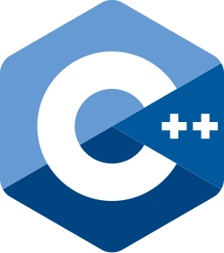

Howdy, I'm Igor!

I am a C++ / Rust Developer, mainly working on my Wine project called Sober.

I code mainly in 3 languages:

And I also use these IDEs:

Currently I work on my main project called Sober, which is a fork of wine.

